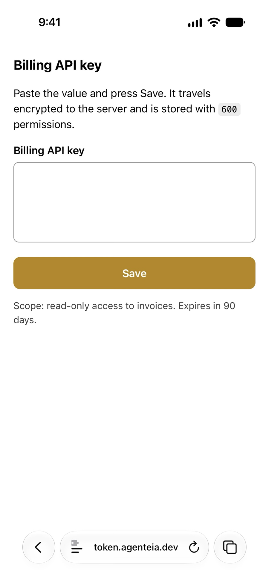
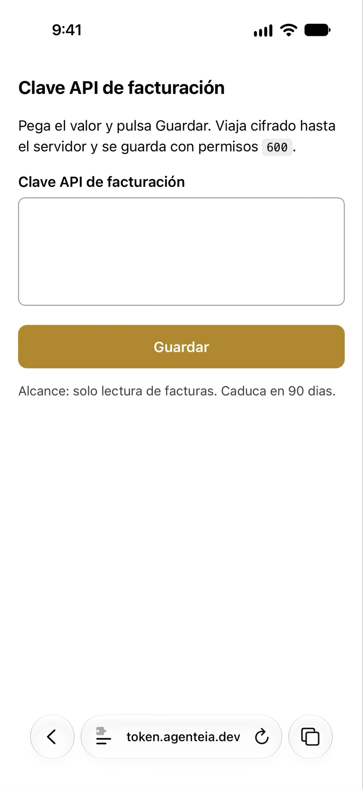

# secret-intake-webform — Hermes skill

Give your agent a way to **receive a secret without it ever passing through the chat**.

An agent that needs an API key, a token, a password or a credential file usually ends up asking for
it in the conversation. That value then lives in the session transcript, in the gateway logs and in
the session backups — permanently. This skill replaces that with a one-time web form, served by the
same machine that needs the secret and reachable through a Cloudflare Tunnel you already own. The
value is written straight to a file with `600` permissions and is never displayed, echoed back or
typed by the agent.

Built for [Hermes Agent](https://hermes-agent.nousresearch.com). Python standard library only — no
dependencies to install.

<p align="center">
  
  &nbsp;&nbsp;
  
</p>

<p align="center"><em>The same form on a phone, in English and Spanish (<code>--lang</code>). This is all the human ever sees.</em></p>

## What it does

- Serves **one** page, at an unguessable 16-hex path, and answers `404` to every other URL —
  including directory listings and anything sitting next to the script.
- Accepts the submitted value at a second secret path and writes it to `--dest` with mode `600`,
  overwriting the file rather than appending.
- Prints the local URL and the public URL, then serves in the foreground so it is easy to stop.
- Says nothing about the value: the log line reports the field label and the number of characters,
  nothing more.

## Contents

| File | What it is |
|---|---|
| `SKILL.md` | The skill itself: when to use it, the full procedure, the security model and the pitfalls |
| `scripts/secret_form.py` | The form server (stdlib only, Python 3) |
| `install.sh` | Copies the skill into your Hermes home, and prints the tunnel steps |
| `examples/cloudflared-config.yml` | How the form's ingress rule fits into a tunnel config |
| `docs/` | The screenshots above |

## Requirements

- Linux or macOS with **Python 3**.
- **Hermes Agent** installed.
- A **Cloudflare Tunnel** for a domain you control, plus a hostname pointed at the local port. A
  Cloudflare **Access** application in front of that hostname is what keeps other people out; without
  it, the unguessable path and a short lifetime are the only protection.

## Install

```bash
git clone https://github.com/rafarq/secret-intake-webform
cd secret-intake-webform
./install.sh
```

| Flag | Effect |
|---|---|
| *(none)* | Install into `$HERMES_HOME` (default `~/.hermes`) |
| `--profile <name>` | Install into `~/.hermes/profiles/<name>` |
| `--dir <path>` | Install into an explicit Hermes home |
| `--help` | Show the help |

The installer is idempotent: running it again refreshes the files. Run it once per profile, because
each Hermes profile has its own home.

Then make the form reachable:

```yaml
# ~/.cloudflared/config.yml — before the catch-all http_status:404 line
ingress:
  - hostname: token.example.com
    service: http://127.0.0.1:8899
  - service: http_status:404
```

```bash
cloudflared tunnel route dns <your-tunnel> token.example.com
systemctl --user restart cloudflared.service
```

Create a Cloudflare Access application for `token.example.com` with an `allow` policy listing the
emails that may open the form. **Use a single-label hostname**: the free Universal SSL certificate
does not cover third-level names such as `form.token.example.com`, and TLS then fails with no useful
error.

## Usage

```bash
python3 ~/.hermes/skills/security/secret-intake-webform/scripts/secret_form.py \
  --dest ~/.hermes/.env.new \
  --campo "API key of the billing service" \
  --host token.example.com
```

| Flag | Default | Meaning |
|---|---|---|
| `--dest` | *(required)* | File the secret is written to (created with `600`, overwritten) |
| `--campo` | `Secret` / `Secreto` | Field label shown on the form |
| `--host` | `token.example.com` | Public tunnel hostname routing to this port — **set it per machine** |
| `--puerto` | `8899` | Local port |
| `--nota` | *(empty)* | Extra HTML shown under the form (context, required scopes…) |
| `--workdir` | `/tmp/secret-form` | Where the form page is generated |
| `--lang` | `en` | Language of the form's own texts (`en`, `es`) |

The agent's flow is: start the form → send the human the link (the link over chat is fine; the value
is not) → wait → verify the file with `stat` → take everything down. `SKILL.md` describes exactly
that, so an agent can follow it on its own.

### Keeping the form up while it waits for a person

If the human will not open the link immediately, do **not** start the form as a child process of your
agent session: when the session ends, the form dies with it and the human finds a dead link. Run it
as a user unit instead, so it survives on its own:

```bash
systemd-run --user --unit=formulario --collect \
  python3 ~/.hermes/skills/security/secret-intake-webform/scripts/secret_form.py \
  --dest ~/.hermes/.env.new --campo "API key" --host token.example.com

systemctl --user stop formulario.service   # when the value has arrived
```

On macOS, use `launchctl` or simply keep the terminal open; the point is the same — the form must not
depend on the agent's session staying alive.

## Verify

```bash
hermes skills list | grep secret-intake-webform      # the skill is registered
curl -s -o /dev/null -w '%{http_code}\n' https://token.example.com/<16hex>.html   # 200, or 302 behind Access
stat -c '%a %s' <dest>                               # 600 and a plausible size
```

Expect `502` from Cloudflare while nothing is listening on the port: that is the tunnel working, not a
misconfiguration. A `302` means Access is asking for identification, which is what you want.

## Security

- The value is written **only** to the file you name, with `600`, on the machine that needs it, and is
  never rendered back to the browser after submission.
- The form page is served by exact path; nothing else in the working directory is reachable, and there
  is no directory listing.
- **Serve it only through the tunnel**, never over plain HTTP on a public interface: the whole model
  assumes HTTPS end to end.
- Access in front of the hostname is what separates "my form" from "anyone's form". Treat a hostname
  without Access as temporary-only, and take it down as soon as the value arrives.
- Cleanup is part of the procedure: stop the process, delete the working directory, and remove
  intermediate copies of the value once it has been moved where it belongs.
- Nothing here protects against a human pasting the wrong secret into a perfectly legitimate form. The
  label and the note are the only guardrail: say what you are asking for and what it will be used for.

## Licence

MIT — original author: Rafael Roa (rafarq).

## Author

Rafael Roa — Technical Architect and Building Engineer, writing about BIM, AI and automation.

- Blog: [rafarq.com](https://rafarq.com)
- LinkedIn: [in/rafaroa](https://www.linkedin.com/in/rafaroa)
- Instagram: [@r4f4r04](https://www.instagram.com/r4f4r04)
- Threads: [@r4f4r04](https://www.threads.net/@r4f4r04)
